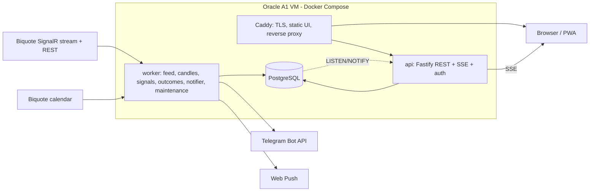

# VM Gold Signal — High-Level Design

Status: v1.0 draft for owner review. The handoff zip is reference material only; this document is the source of truth.

## 1. Goal

A private XAU/USD decision-support system. It watches live gold prices 24/5, produces BUY/SELL signals with entry, stop and targets, explains in plain language why each signal was produced, shows the historical evidence for that kind of setup, and follows every signal to a final result with an automatic post-mortem. Alerts go to Telegram (primary) and Web Push. A private web dashboard shows live state, signal history and analytics.

Non-goals for V1: automatic order execution, multiple users, paid data or services, an LLM in the signal path, any guarantee of profit.

## 2. Constraints and principles

| # | Rule |
|---|---|
| C1 | Software and infrastructure cost is zero. Anything that would cost money is optional and off by default. |
| C2 | Execution is manual. The system never places orders. |
| C3 | Missing, stale or inconsistent data means no signal (`NO_TRADE`), never a guess. |
| C4 | Signal decisions are deterministic code. Same inputs give the same signal (replayable). |
| C5 | Every signal is immutable once written. Results and analysis are appended, never overwritten. |
| C6 | Shown win rates come from recorded outcomes with sample size and confidence interval. No invented probabilities. |
| C7 | The database must not grow without bound. Retention is automatic, and statistics never depend on data that is about to be purged. |
| C8 | Simulated or replayed data is always labelled `SIMULATED` in UI and alerts. |
| C9 | Early signals are labelled `FORWARD-TEST` until a strategy has earned `VALIDATED` status (see 02_Signal_Engine, section 15). |
| C10 | Signals are never throttled by count, time of day or recent results. Only missing or unreliable data and a trade whose maths does not work can stop a signal. Every other risk condition is a warning on the signal. |

## 3. Cost model

| Component | Choice | Cost | Real risk | Mitigation |
|---|---|---|---|---|
| Compute | Oracle Always Free Ampere A1 (2 OCPU, 12 GB) | 0 | Signup needs a card for verification. "Out of capacity" at creation. Idle instances may be reclaimed (7 days with CPU p95, network and memory all under 20%). | Keep memory use above 20% naturally (Postgres cache). Retry creation. Fallback: owner's own always-on PC. |
| Domain / TLS | DuckDNS subdomain + Caddy automatic certificates | 0 | Third-party free DNS. | Hostname is config. Can move to any domain later. |
| Frontend hosting | Served by Caddy from the same VM | 0 | Same failure domain as API (acceptable, UI is useless without API). | None needed. |
| Market data | Biquote (SignalR stream, REST) | 0 | No SLA. Can change or stop without notice. Prices are indicative (broker CFD feed). | Provider interface, own tick recorder, stale-feed gate, divergence check later. |
| Economic calendar | Biquote calendar | 0 | Same as above. Only about 90 days window. | Archive into own DB daily. |
| Headline news | RSS feeds (BBC, Al Jazeera, CNBC, Federal Reserve) and the Biquote news endpoint | 0 | Minutes of delay, no direct social-media posts, each feed's terms apply (headline and link only). | Source list is configurable; a feed can be disabled or replaced. |
| Alerts | Telegram Bot API, Web Push | 0 | Telegram limits about 1 message per second per chat (fine). Web Push on iPhone needs the installed PWA. | Outbox with retry and expiry. |
| Backups | pg_dump encrypted with age, stored in OCI Object Storage (20 GB free) | 0 | Same cloud account. | Periodic manual download to the owner's PC. |
| CI | GitHub Actions free tier (2,000 minutes a month for private repositories) | 0 | Minute quota. | Lean pipeline, no scheduled jobs. |
| Uptime alert | Healthchecks.io Hobbyist plan (free, 20 checks); the worker pings it every minute | 0 | Third-party service. | Alerts the owner when pings stop (VM or worker down). |
| WhatsApp | Not used. Adapter exists, disabled. | would cost | Template messages are billed per message. | Off by default. |
| LLM / RAG | Not in V1. | 0 | n/a | Optional later phase, advisory only. |

Honest summary: no software line item costs money. The real risks are the Oracle signup/capacity/reclaim behaviour and a free feed without an SLA.

## 4. Architecture



Two application processes plus the database and the proxy. This is deliberate: fewer moving parts is more stable on a small free VM.

### 4.1 Processes

| Process | Responsibilities |
|---|---|
| `caddy` | TLS certificates, HTTP to HTTPS, security headers, serves the built web app, proxies `/api` to `api` (no response buffering for SSE). |
| `api` | REST, SSE fan-out, authentication, settings, analytics queries. Read-mostly. Restarting it never affects signal generation. |
| `worker` | Feed adapter, tick recorder, candle builder, feature engine, regime, strategies, risk, signal persistence, outcome tracker, post-mortem, outbox sender (Telegram, Web Push), Telegram command handler, calendar poller, headline poller and classifier, market-move detector, maintenance jobs, heartbeats. |
| `db` | PostgreSQL 17 (pgvector image so a later RAG phase needs no image change). Not published outside the Docker network. |
| `backup` | Scheduled job (host systemd timer or a tiny container) running pg_dump, age encryption and upload. |

### 4.2 Worker internal modules

```text
feed adapter -> normalizer -> tick recorder (batched insert)
                          \-> candle builder (1m, then 5m/15m/1h/4h/1d)
candle close -> feature engine -> regime -> strategies -> blocking gates + advisory flags -> risk
             -> signal transaction (signal + event + explanation + outbox) -> NOTIFY
ticks        -> outcome tracker (open signals) -> outcome transaction -> autopsy queue
outbox       -> sender loop (Telegram, Web Push) with retry and expiry
timers       -> calendar poll, headline poll + classify, move detector, REST market-state poll, heartbeats, maintenance
```

The outbox sender runs on its own async loop with timeouts so a slow Telegram call can never delay signal evaluation.

### 4.3 Feed package (`packages/feed`, B11)

Everything between the provider and the worker. The worker (B12) only wires it to the recorder and the candle builder.

- **Interface.** A `QuoteProvider` (named so because `core` already has a `FeedProvider` string union) gives raw quotes, malformed messages, connection changes and market-state changes, plus a `clock`. Three providers: `BiquoteProvider` (live), `ReplayProvider` (recorded events, the clock is the recorded time, nothing reads the wall clock, so the same input gives the same output) and `SimulatedProvider` (a seeded random walk with injectable faults, for development without a network and for e2e). `core`'s `FEED_PROVIDERS` stays `biquote | replay`; `simulated` is not stored anywhere.
- **`Feed`** joins a provider, the `TickNormalizer` and the `FeedMonitor`. It emits `tick`, `rejected`, `state` and `incident` events and answers `health()` (state, connected, market state, newest tick, tick age, ticks per second, clock skew, spread) for the Health tab. A listener that throws never stops the others; the error is rethrown outside the provider callback.
- **Normalizer** (step 1 of section 5). Rejections are counted per reason, none is silent: `MALFORMED`, `UNKNOWN_SYMBOL`, `BAD_TIME`, `BAD_PRICE`, `CROSSED` (after rounding to thousandths), `FUTURE` (more than 5 minutes ahead of the receive time, the candle builder's limit), `DUPLICATE` (one of the last 16 quotes of the symbol), `OUT_OF_ORDER` (more than 2 seconds older than the newest, the candle builder's limit), `JUMP` (mid moves more than 1 % between quotes). Three suspicious quotes in a row that agree within 0.2 % are a real move and the new level is accepted (`levelReset`); after a silence of more than 5 minutes a new level is believed at once, because a weekend gap is real. `prime()` takes the last stored tick so that a restart does not store the same quote twice.
- **State** (`FeedMonitor`, pure, driven by explicit times). Precedence: `LIVE` when connected and the newest tick is at most `maxTickAgeSec` (10 s) old by its source time (fresh data beats a "closed" claim); else `MARKET_CLOSED` when the provider says closed (believed for 120 s) or the weekly schedule is closed (Friday 17:00 to Sunday 17:00 New York, a floor); else `DISCONNECTED` when not connected; else `STALE`. `WARMING_UP` belongs to the worker, not to the feed. The defaults equal the gates of `02_Signal_Engine.md` (tick age 10 s, clock skew 5 s, spread 0.6 USD) and a test fails if they drift.
- **Incidents** (`feed_incidents`). One episode of lost data is one incident (`STALE`, or `DISCONNECT`; a stale feed that then disconnects stays one incident with `disconnected: true` and the reason). It is opened only after a 5 second grace and dated back to the real start; if it ends later than the grace, OPEN and CLOSE come together. `MARKET_STATE` opens at once when the market closes (`reason: provider | schedule`, `weekend`). `CLOCK_SKEW` opens at a median receive-minus-source difference of 5 s or more (last 30 quotes, at least 5) and closes below 2.5 s. `SPREAD_SPIKE` opens at a spread of 1 USD or more and closes after 10 calm seconds, dated at the last wide quote. `GAP` incidents are not made here: B12 writes them from the candle builder's `FeedGap`. A replay has no timer, so it never reports a stall.
- **Biquote adapter** (probed live on 2026-10-24; the vendor publishes no protocol description). Hub `https://biquote.io/hubs/tick`, JSON protocol. The client calls `Subscribe([symbols])`; the server sends `ReceiveTick` (symbol, bid, ask, timestamp as ISO with `Z` and whole seconds, spread, mid and more) and, once after subscribing, `ReceiveSubscriptionState` (`open` or `closed` and the quote age per symbol). Hub ticks carry no stale or market-state flags; `GET /api/{symbol}` does (`marketState`, `stale`, `quoteAgeSeconds`), so it is polled every 30 seconds. After `Subscribe` the server sends the last cached tick again, possibly hours old on a closed market; this is why the normalizer drops duplicates and the monitor judges age by source time. A timestamp without a zone is refused (`Date` would read it in the machine's zone). Receive minus source time is about 1 second (whole-second stamps add 0.5 s on average).
- **Reconnect.** The adapter runs its own loop instead of SignalR's automatic reconnect: waits of 1 s, doubling, capped at 60 s, with 20 % jitter. The wait returns to 1 s only after a connection has held for 10 seconds, so a flapping server escalates. A failed connect gives one `connection: false` event. A watchdog covers a connection that is up but silent while the market is open: no quote for the traded symbol for 30 s means subscribe again once, for 60 s means connect again. A closed market (provider information, else the weekly schedule) pauses the watchdog.
- **Tests.** The adapter is tested against `FakeSignalRServer` (`src/testing`, built on `ws`, a dev dependency): the SignalR JSON protocol with negotiate, upgrade, handshake, invocations, pings and close, so reconnects, drops, silence and the seeded tick run over a real socket. The real hub was probed manually (BTCUSD was open at the time, about one quote per second; XAUUSD was closed for the weekend).

## 5. Signal path (runtime)

1. The feed delivers ticks (bid, ask, source timestamp). Ticks are validated: monotonic enough, ask >= bid, sane price jump.
2. Ticks update the in-memory 1m candle. When a minute closes it is persisted, then higher timeframes are derived from closed candles only.
3. When a 5m candle closes, the decision step runs once (no repaint, no intrabar signals): features, regime, strategies, gates, risk, quality score.
4. If a setup passes, a single DB transaction writes: `signals` row (immutable), `signal_state`, `signal_events(CREATED)`, `signal_explanations` content inside the signal, and `notification_outbox` rows. After commit the worker issues `NOTIFY` and the sender picks up the outbox.
5. API process receives `NOTIFY`, reads the canonical row, pushes an SSE event to browsers.
6. For every tick the outcome tracker checks open signals (stop, targets, time stop) and writes events. On close it writes `signal_outcomes`, updates statistics rollups in the same transaction, queues result alerts, and schedules the post-mortem.
7. The post-trade review (section 12 of 02_Signal_Engine) runs after the close and finalizes after an observation window.

Nothing in this path calls an external service except the database. Telegram, calendar and any later LLM run off the critical path.

## 6. Stability and failure modes

| Failure | Behaviour |
|---|---|
| Feed disconnected or no tick for `gates.maxTickAgeSec` (10 s) | State `DATA_STALE`. No new signals. Open signals keep being managed only with fresh ticks. One alert on entering, one on recovery. |
| Market closed (weekend, maintenance) | State `MARKET_CLOSED` from provider `marketState` plus schedule. No alerts. Worker stays up. |
| Feed gap during an open trade | Outcome becomes `DATA_INVALID`, excluded from win rate, counted separately. |
| Spread spike | A blocking gate fails (the trade maths no longer works). No signal; the WAIT reason is shown. |
| Calendar source down | News state `UNKNOWN`. Signals continue with a `NEWS_UNKNOWN` warning. UI shows "news feed unavailable", distinct from "no events". |
| Headline feeds down | One `SYSTEM_DEGRADED` notice per incident, a banner on the News page. Signals continue and the news line says "headline feed unavailable" instead of "no headlines". |
| Database unavailable | No signals, no alerts (never alert from memory). Worker retries with backoff. |
| Telegram unavailable | Outbox retries with backoff. Messages past `expires_at` are dropped as `EXPIRED` (an entry alert 10 minutes late is harmful). Dashboard unaffected. |
| Worker crash or restart | Restart policy `unless-stopped`. On start it reloads open signals from DB, rebuilds in-memory candles from DB, and blocks signals until warm-up is complete. |
| Clock drift | Compare receive time vs source time. If skew beyond threshold, timing-sensitive signals are blocked and an alert is sent. NTP on the VM. |
| VM down | The worker pings Healthchecks.io every minute; when the pings stop, Healthchecks.io alerts the owner (Telegram or email). A scheduled GitHub job was rejected: one run every 10 minutes would likely exceed the 2,000 free minutes. |
| Disk filling | Maintenance job tightens tick retention and alerts (see 7). |

Reconnect uses exponential backoff with jitter and a cap. After reconnect the engine requires fresh data before signals resume.

## 7. Data retention and storage budget

Goal: the database stays small and fast, history that matters for statistics is never lost.

| Data | Default retention | How |
|---|---|---|
| Raw ticks (XAUUSD) | 14 days | Daily partitions, old partitions are dropped (instant, no bloat). |
| 1m candles | 180 days | Batched delete. |
| 5m, 15m, 1h, 4h, 1d candles | Kept (a few MB per year) | none |
| Signals, events, outcomes, autopsies | Kept forever (tiny) | none |
| Signal feature snapshots | Kept 365 days in full, then trimmed to essential fields | Nightly job. |
| Statistics rollups (bucket, monthly, evidence, failures) | Kept forever | Updated incrementally at signal close, reconciled nightly. |
| Notification outbox | Sent: 30 days. Failed or dead: 90 days | Nightly job. |
| Gate rejections (`rejections`, used for "WAIT: reason") | 30 days | Nightly job. |
| Worker/feed incidents, maintenance runs | 90 days | Nightly job. |
| Sessions, login attempts | Expired sessions daily, attempts 30 days | Nightly job. |
| Security audit events | 365 days | Nightly job. |
| Macro calendar events | Kept (small, needed for research) | none |
| Headlines (`news_items`) | 30 days | Nightly job. Headlines shown with a signal or a market event are copied into them and kept with them. |
| Market events (`market_events`) | 12 months | Nightly job. |
| News impact samples and topic stats | Kept (tiny) | none |

Estimated volume: about 2.4 ticks per second while the market is open is roughly 13 MB per day, so 14 days of ticks is under 200 MB. Everything else is a few tens of MB per year.

Safety rules: retention jobs never touch `signals`, `signal_events`, `signal_outcomes` (these tables also reject UPDATE, DELETE and TRUNCATE by trigger). A size guard compares database size and disk usage with soft limits (database 10 GB, disk 70%). On breach it shortens tick retention, writes a `maintenance_runs` row and sends a Telegram warning. The System page shows sizes per table and last maintenance run.

Backups: nightly `pg_dump` excluding tick partitions, encrypted with age, uploaded to OCI Object Storage. Keep 7 daily, 4 weekly, 3 monthly. A monthly restore test script verifies the backup restores into a scratch database.

## 8. Security

- Single owner account stored in a one-row table. No registration. Password hashed with Argon2id, set through a server-side CLI command, never printed.
- Opaque server-side sessions in Postgres. Cookie `__Host-vmgs_session`, `Secure; HttpOnly; SameSite=Strict; Path=/`. Same origin for UI and API, so this works without CORS.
- State-changing requests require the session cookie, an `Origin` header equal to the site origin, and a custom header. No separate CSRF library is needed with strict same-site cookies plus these checks.
- Optional TOTP second factor (feature flag, secret encrypted with an app key using AES-256-GCM from `node:crypto`). Recovery codes stored hashed.
- Login throttling backed by the database (survives restarts). Generic failure message.
- Telegram bot answers only the configured owner chat id. Every other chat is ignored.
- Caddy sets HSTS, CSP, `frame-ancestors 'none'`, `X-Content-Type-Options`, `Referrer-Policy`, `Permissions-Policy`. API responses use `Cache-Control: no-store`.
- Postgres is never published to the host. Two database roles: `vmgs_worker` (writes market and signal data) and `vmgs_api` (reads everything, writes auth, settings, push subscriptions, audit).
- Cloud firewall: 80 and 443 public, SSH limited to the owner's IP. Docker does not publish other ports.
- Secrets live in a root-owned `.env` file (mode 600) outside git. TLS verification is never disabled.
- Audit log for logins, logouts, settings changes, strategy status changes, notification tests.

## 9. Technology stack (versions verified against the npm registry on 2026-10-23)

Re-query the registry at the start of B0 and pin exact versions in the lockfile. Never use alpha, beta or RC builds.

| Area | Choice |
|---|---|
| Runtime | Node 24 LTS (24.22.1; the full server stack was verified on it). The dev machine may use Node 22.22; production and CI use 24. |
| Language | TypeScript 6.0.3. TypeScript 7 is not used because `typescript-eslint` 8.72 supports only versions below 6.1. |
| Monorepo | pnpm 10.34.x workspaces (pnpm 12 exists; we stay on the maintained 10 line until after V1). pnpm 10 blocks dependency install scripts by default and none are allowed, because nothing in the stack needs them (verified). |
| Web | React 19.3.1, Vite 8.3.5, `@vitejs/plugin-react` 6.1.2, Mantine 9.7.3 (`core`, `hooks`, `form`, `notifications`, `dates`, `charts`), `mantine-datatable` 9.4.0, `mantine-form-zod-resolver`, TanStack Query 5.104.5, `react-router` 8.5.0, `lightweight-charts` 5.2.1, `vite-plugin-pwa` 2.0.0, `dayjs` and `recharts` (peers of Mantine dates and charts). The web tsconfig uses `lib: [ES2025, DOM]` and `skipLibCheck` because Mantine's typings use `ReadonlySetLike` |
| API | Fastify 5.12.7 with `@fastify/cookie`, `@fastify/helmet`, `@fastify/rate-limit`, `@fastify/sensible`, `@fastify/type-provider-zod` 1.0.1 (with its peer `@fastify/swagger`), Zod 4.6.7, Pino 10.4.0 |
| DB | PostgreSQL 17 (`pgvector/pgvector:pg17`), `pg` 8.23.1, Kysely 0.29.7 for typed queries with types generated from the migrated database by an in-repo generator (`packages/db/src/codegen.ts`), plain SQL migrations with a small forward-only runner |
| Feed | `@microsoft/signalr` 10.0.11 (Biquote uses a SignalR hub, not a plain WebSocket). `ws` 8.22.0 is a dev dependency of `packages/feed` only: it runs the local fake SignalR server of the adapter tests |
| Alerts | Telegram through a thin typed client on native `fetch` (sendMessage, getUpdates long polling, `retry_after` handling; `grammy` was rejected because it pulls legacy `node-fetch@2`), `web-push` 3.6.7 (old but verified: VAPID and payload encryption work on Node 22 and 24; isolated behind an interface) |
| Auth | `@node-rs/argon2` 2.2.2 (Argon2id, prebuilt binaries including linux-arm64; the `argon2` package needs an install script that pnpm blocks), `otplib` 13.5.0 |
| Test | Vitest 5.0.5, `@testcontainers/postgresql` 12.2.1, Playwright 1.64.1, `@axe-core/playwright` 4.14.0, `trading-signals` 8.3.0 (independent oracle for indicator tests only) |
| Lint | ESLint 10.13 with `typescript-eslint` 8.72 (type-aware), `eslint-plugin-react-hooks` 7.1.1, Prettier 3.9. `eslint-plugin-jsx-a11y` is not used (it does not support ESLint 10); accessibility is covered by axe tests |
| Proxy | Caddy 2 |
| Other | `fast-xml-parser` 5.11.2 (RSS; must use `htmlEntities: true`, otherwise `&#39;` stays undecoded), `fflate` 0.8.3 (HistData zip files), `tsx` 4.23.15, `@types/node` 24 (not the newest 26, to match the runtime). No date library: `Intl` handles IANA zones and DST (verified for America/New_York and Asia/Kolkata) |

Tailwind is not used. Mantine provides styling, which removes a whole layer.

Migrations are plain SQL files applied by a small forward-only runner (ordered files, a `schema_migrations` table with checksums, a Postgres advisory lock, one transaction per file), because partitions, triggers and views are not covered by ORM migration generators. Query types are generated from the migrated database by a small in-repo generator (`pnpm --filter @vmgs/db codegen`, reading `pg_catalog` from a throw-away Testcontainers database), committed, and a test fails if they are stale, so there is no second hand-written schema to drift. `kysely-codegen` (the original plan) was dropped in B2 because the package is blocked by the organisation's content policy in the development environment; the generator is about 120 lines, has no extra dependency and removes the dev-only `braces` advisory, but `pnpm audit --prod` stays the CI gate.

### Stack verification record (2026-10-23)

A throwaway workspace with every planned package was installed and exercised: no peer conflicts, `tsc` clean for the server (NodeNext) and the web app (bundler), type-aware ESLint 10, a Vitest 5 test, a Vite 8 production build with the PWA service worker, and a runtime smoke test on Node 22.22 and Node 24.22.1 covering Fastify with the Zod type provider, argon2id, TOTP, Web Push encryption, the SignalR client, RSS parsing, zip handling, Kysely, an RSI cross-check and Intl time zones (America/New_York DST verified). `pnpm audit --prod` reported no known vulnerabilities. Findings that changed the plan are the ones marked in the table above: `@node-rs/argon2` instead of `argon2`, a thin native-fetch Telegram client instead of `grammy`, Kysely instead of Drizzle, no `jsx-a11y`, no date library, `@types/node` 24, and the `htmlEntities` option for RSS. `lightweight-charts` is Apache-2.0 and the TradingView attribution it displays must stay visible.

## 10. Repository layout

```text
apps/
  api/            Fastify REST, SSE, auth, settings
  worker/         feed, signals, outcomes, notifier, telegram, maintenance
  web/            React + Mantine dashboard (PWA)
packages/
  core/           pure domain code, no IO: types, indicators, structure, regime,
                  strategies, risk, outcome model, autopsy, statistics, explain/formatters
  contracts/      Zod schemas for API and SSE shared by api and web
  db/             SQL migrations, migration runner, generated Kysely types, queries
  feed/           Biquote provider, replay provider, simulated provider
  config/         environment and runtime configuration schemas
tools/
  research/       HistData importer, backtester, experiment registry CLI
  cli/            create-owner, rotate-secrets, db tools
deploy/           docker-compose.yml, Caddyfile, backup scripts, .env.example
e2e/              Playwright tests
docs/             this documentation
```

`packages/core` has no IO and no clock access (time is injected). That makes the engine fully testable and lets the backtester and the live worker run the same code.

## 11. Testing and quality gates

| Layer | Tooling | Scope |
|---|---|---|
| Unit | Vitest | Indicators against known vectors, candle aggregation, pivots/BOS/CHoCH/sweep fixtures, risk math, R accounting, autopsy rules, Wilson interval, message formatters. |
| Replay | Vitest | Fixture tick files produce byte-identical candles, features and signals on every run. |
| Integration | Vitest + Testcontainers | Migrations, immutability triggers, signal transaction, outbox idempotency and expiry, retention jobs, rollup reconciliation. |
| API | Fastify `inject` | Auth, cookie flags, rate limit, session revocation, CSRF checks, no-store headers, every endpoint contract. |
| SSE | Vitest | Heartbeat, ordering, `Last-Event-ID` replay. |
| E2E UI | Playwright | See 05_UI_Spec section 9. DOM and accessibility assertions only. No screenshot or visual-diff testing. |
| Security | Vitest/Playwright | No registration route, unauthenticated rejection, cookie flags, security headers. |

Gate for every phase: typecheck, lint, all tests green, no TODO that hides a missing requirement. A phase is not closed with failing tests.

## 12. Deployment and operations

- Single `docker compose up -d` on the VM: `caddy`, `api`, `worker`, `db`. Images are built on the VM itself (native arm64) from the tagged release.
- Zero-downtime is not a goal. Deploys take seconds, the worker rebuilds state from the DB on start.
- Health endpoints: `/health/live`, `/health/ready` (DB, migrations, worker heartbeat), `/api/v1/system/health` (rich, authenticated).
- Logs are structured JSON (Pino) with rotation by Docker. Latency metrics (feed lag, candle-to-signal, DB commit, notify dispatch) are kept in memory and exposed on the System page as p50/p95.
- Owner setup steps and phase plan are in 06_Phases_and_Setup. API, stream and Telegram contracts are in 04_API_and_Notifications. Screens and e2e scenarios are in 05_UI_Spec.

## 13. Known limits (stated up front)

- A free feed has no SLA and 1-second timestamp resolution. Treat the system as forward-test and paper-trade grade until a strategy has real forward evidence.
- Prices are an external broker CFD feed, not the owner's broker. Entries on the owner's broker will differ slightly. Every signal carries a maximum valid entry for this reason.
- No indicator set can guarantee profit. The system is built to measure honestly, show failures with reasons, and let the owner decide.

## 14. Manual execution and regulatory note

- Execution is manual. The owner reads the Telegram message (or the dashboard) and places the order in the broker's trading app. Elefin's website lists MetaTrader 5 and its own WebTerminal ("desktop, tablet and mobile"). MetaTrader 5 has mobile apps for Android and iOS that support market and pending orders with stop loss and take profit. Elefin's site lists MT5 only, not MT4.
- Paper-trading phase: take the signals on a demo account (virtual money) and compare with the system's own tracked result. A later phase (L1) adds a Telegram command to record the owner's real fill so slippage against the signal can be measured.
- Prices differ between feeds and brokers. Every signal carries a maximum valid entry for this reason.
- Spot gold on margin has no expiry and no option theta, but it has spread, overnight financing, very high leverage (Elefin advertises up to 1:2000) and broker counterparty risk. Futures have no theta either (theta applies to options). It is a different set of risks, not a risk-free alternative.
- Regulatory note (not legal advice): the RBI Alert List (updated 19 November 2025, 95 names including several large international brokers) names entities that are neither authorised to deal in forex under FEMA nor to operate electronic trading platforms for forex in India, and says the list is not exhaustive and that an entity missing from it must not be assumed authorised. Elefin's website shows a company registration in Saint Lucia and, on the pages checked, no financial-regulator licence and no India-specific authorisation. Before any real-money trading the owner should take independent legal and tax advice. Exchange-traded gold in India (for example MCX gold futures) is the regulated route; a future adapter could map XAUUSD signals to it. This project only produces signals. It does not open accounts, route orders or handle funds.
